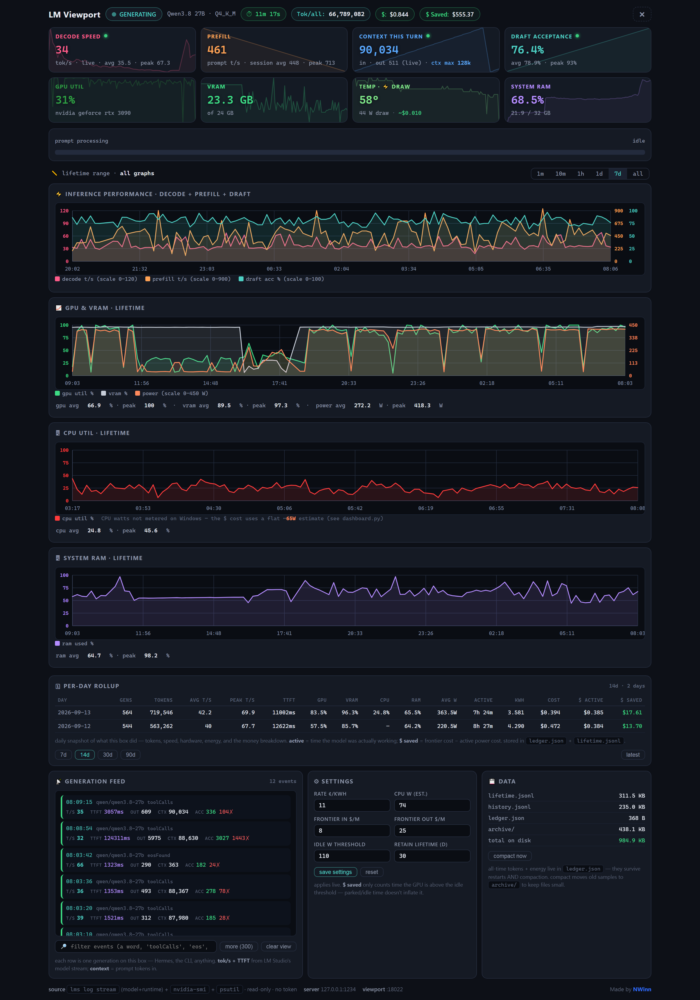

<div align="center">

# LM Viewport

**A live, read-only telemetry dashboard for your local LM Studio inference server.**

`Python` · `no API token` · `no second model` · `local-only` · `MIT`

[]()
[]()
[]()

</div>

---

LM Viewport sits next to your running LM Studio server and turns its already-
emitted logs into a real-time cockpit: decode/prefill speed, draft acceptance,
GPU/VRAM/temperature/draw, system RAM, prompt-progress, plus **lifetime charts**,
a **per-day rollup with energy + cost + $-saved**, and a scrolling **generation
feed**. It accumulates a durable all-time ledger so your totals survive restarts.

It is **strictly read-only** — it never loads a model, never sends a prompt, and
never touches a token. It reads LM Studio's own local `lms` log streams,
`nvidia-smi`, and (optionally) `psutil`, all on `127.0.0.1`.

> The numbers in the screenshots below are the author's own telemetry (real
> tokens, watts, and dollars from their machine). Yours will be different —
> the layout is what to expect.

---

## The whole dashboard



Everything on one screen: header status bar, live tiles with sparklines, a
prompt-progress bar, four lifetime charts, a per-day rollup table, the
generation feed, and live-editable settings + data panels.

## Quick start

### Requirements
- **LM Studio** installed — the dashboard works whether the app is **open or closed**: it reports `OFFLINE` when the app is down and keeps showing GPU / RAM / energy either way (you can leave it running for non-AI monitoring)
- **Python 3.8+** on your `PATH`
- **NVIDIA GPU** (for the GPU/VRAM/temp/draw tiles via `nvidia-smi`) — optional but recommended
- **`psutil`** (optional) — enables the *System RAM* tile. Without it that one tile is hidden and everything else works.

### Install
```bash
git clone https://github.com/NWinnVR/lmstudio-viewport.git
cd lmstudio-viewport

# optional — enables the system RAM tile
pip install psutil
```

### Run
**Windows:** double-click **`run_viewport.bat`** (starts windowless, no console left open).

**Linux / macOS:**
```bash
./run.sh          # or: python3 dashboard.py
```

Then open **http://127.0.0.1:18022** in your browser.

To stop it: click the **✖** button in the viewport header (your model/server keeps running), or `pkill -f dashboard.py`.

> **First run is instant.** The dashboard starts empty and fills in as LM
> Studio emits events. The *lifetime* charts and *per-day rollup* populate
> over time — they're cumulative logs, not live probes.

## How it works — in one breath

Reads LM Studio's *own* local `lms` log streams + `nvidia-smi` (+ optional
`psutil` / LibreHardwareMonitor CPU watts) — **never** the inference API, never
a second model. Binds to `127.0.0.1` only by default; it's a passive observer
(every `lms` call is gated behind a TCP probe) so it can't relaunch the app —
[full details](docs/how-it-works.md).

**Optional extras (all off by default):** [CPU power via LibreHardwareMonitor](docs/setup-and-use.md#cpu-power-optional) · [phone / LAN mode with write-token gating](docs/setup-and-use.md#phone--lan-optional)

---

## More docs (the wiki)

The full documentation lives in [`docs/`](docs/index.md), split out so this
README stays a quick guide:

| Page | What's on it |
|---|---|
| [Tour — every panel, up close](docs/tour.md) | The header pill states, all 8 live tiles, prompt progress, the four lifetime charts, per-day rollup, generation feed, settings + data panels. |
| [How it works](docs/how-it-works.md) | Exactly which local streams are read (and which aren't), why it can never relaunch LM Studio, and privacy by design. |
| [Setup & everyday use](docs/setup-and-use.md) | Requirements → install → run, the CPU-power optional setup, phone / LAN mode step-by-step, every configuration knob + power model, and the full file listing. |
| [API reference](docs/api.md) | Every JSON endpoint if you want to script against it. |
| [Troubleshooting](docs/troubleshooting.md) | Every "when X happens → do Y" in one place. |
| [Changelog](docs/changelog.md) | The complete version history, newest first (v1.3.4 → v1.0.0). |

---

## Contributing

Ideas, PRs, and issues are welcome. Bump the version in `dashboard.py`
(`VERSION`) for any change — minor for fixes/adds, major only on explicit intent.

## Credits

- **LM Studio** — the local inference server whose logs this reads (made by
  [LM Studio](https://lmstudio.ai)).
- **Grafana** — the multi-axis, color-coded time-series *layout* here follows
  [Grafana](https://grafana.com)'s dashboard conventions. **No Grafana code is
  included or linked**; this is a self-contained re-implementation of that
  look. (Grafana is distributed under **AGPL-3.0**, which only applies if you
  incorporate its code — we don't, so it carries no obligations here.)
- **EIA** — US electricity-rate average used as the default `cost_per_kwh`
  ([Energy Information Administration](https://www.eia.gov/electricity/data/browser/)).
- **NWinn** — author (VR: nwinn). Attribution link is in the dashboard footer.

## License

MIT — see [LICENSE](LICENSE).
