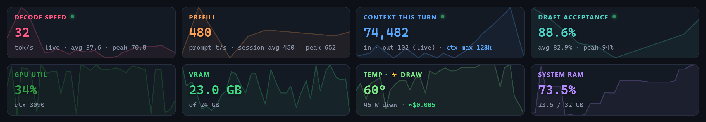
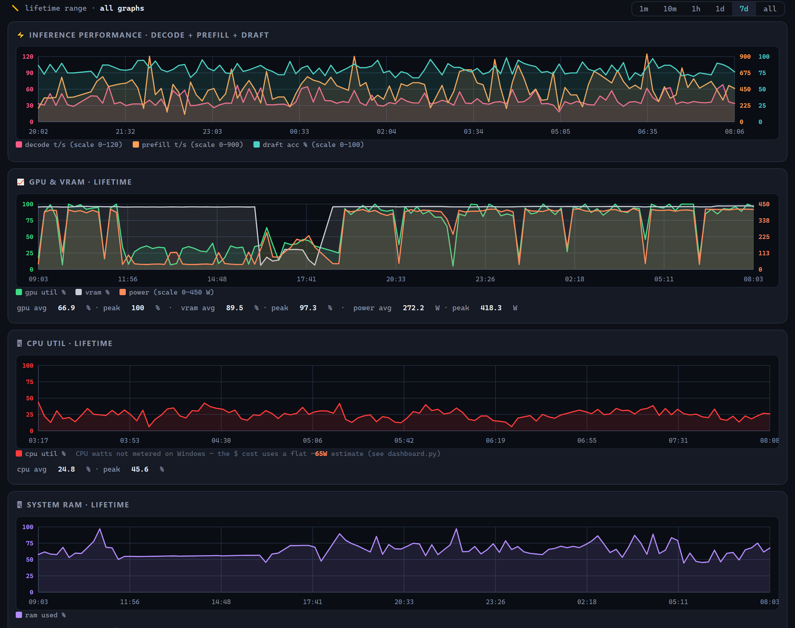
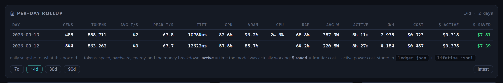
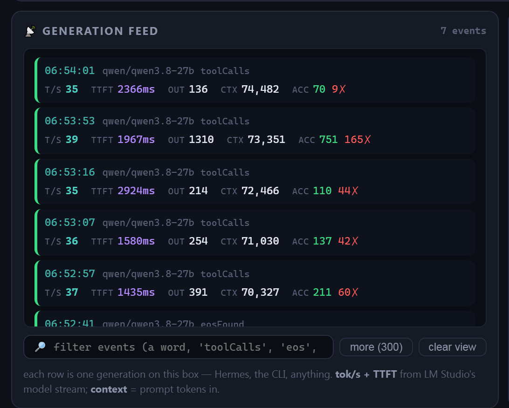
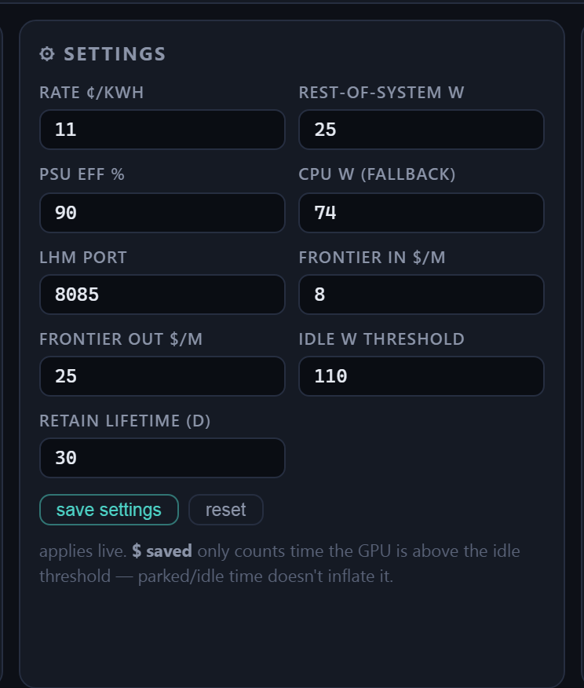
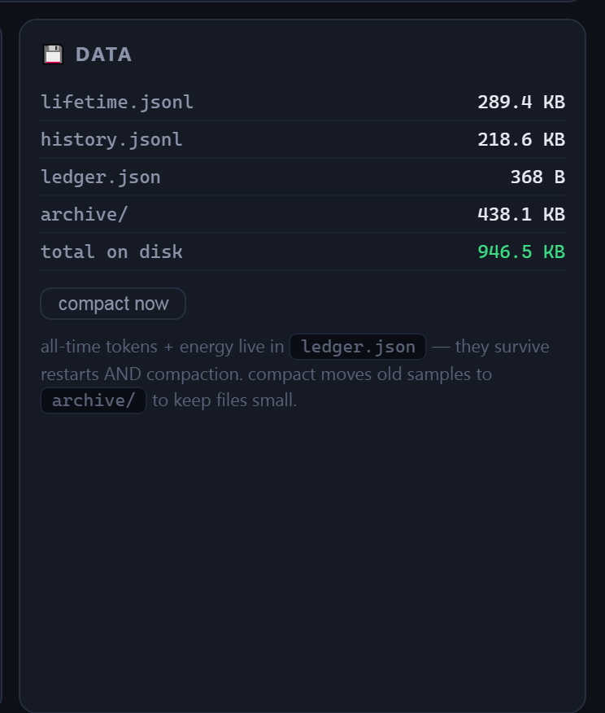

← [README](../README.md) · [Wiki index](index.md)

# Tour — every panel, up close

### Header · status, model, uptime, totals

Left to right: the **status pill**, the **loaded model**, how long it's been
loaded, **all-time tokens**, **all-time electricity cost**, and **$ Saved**
(estimated savings vs. running the same tokens on a frontier API, counted only
while the GPU was actively working).

The pill has **three states** plus a live one:

| Pill | Meaning |
|---|---|
| 🟩 `READY` / `GENERATING` | model loaded — idle / actively producing |
| 🟧 `RUNNING · no model` | LM Studio is open but nothing is loaded |
| 🟥 `LM STUDIO OFFLINE` | the app is closed |

…and the **model label** beside it updates to whatever is actually loaded,
clearing to *no model loaded* when nothing is (it never shows a stale model).

### Live tiles · the real-time needles

Eight tiles, each with a faint **sparkline** of its own last few minutes behind
the number:

| Tile | What it is |
|---|---|
| **Decode speed** | live tokens/sec while generating — the headline speed |
| **Prefill** | how fast the prompt is read in (tokens/sec) |
| **Context this turn** | tokens in this generation + your max context window |
| **Draft acceptance** | spec-decoding: % of draft tokens the big model accepted |
| **GPU util** | nvidia-smi utilization % — the **card name is auto-detected** (your GPU, not a hardcoded one) |
| **VRAM** | memory in use / total |
| **Temp · ⚡ Draw** | GPU temperature + live power draw (the only tile with the bolt) |
| **System RAM** | via `psutil` (optional) |

Counters flush to **0 when the model is idle** (rather than freezing on the last
value), and the little `avg` / `peak` figures are computed **only over active
generation time** — idle time never drags them down.

### Prompt progress
A thin progress bar under the tiles tracks **prompt processing** (prefill) live.
It reads `idle` between prompts and fills while a long prompt is being read in.

### Lifetime charts · the long view

Four line charts over any range (**1m / 10m / 1h / 1d / 7d / all**),
each with avg + peak in the legend:

- **Inference performance** — decode + prefill + draft acceptance
- **GPU & VRAM** — utilization, VRAM %, and power draw
- **CPU util** — utilization (CPU watts aren't metered on Windows, so a flat
  platform estimate is folded into the energy math instead)
- **System RAM** — memory % over time

### Per-day rollup · the money shot

A daily table of what the box actually did — generations, tokens, avg/peak
speed, TTFT, GPU/VRAM/CPU/RAM, average draw, **active time**, **kWh**,
**cost**, **$ active**, and **$ saved**. Pick the range (7d / 14d / 30d / 90d).
`active` = time the model was actually working (GPU above your idle threshold);
`$ saved` = frontier cost − active power cost.

### Generation feed · the log

A scrolling feed of recent generations — timestamp, model, tokens/sec, TTFT,
output length, context, and draft acceptance. Filter, load more, or clear the
view. This is your event-level record.

### Settings · live-tweakable knobs

Edit your numbers without restarting: **electricity rate** (¢/kWh), **CPU
wattage estimate**, **frontier in/out** ($/M) used for `$ saved`, the **idle
watt threshold** (what counts as "working"), and how many **days** of lifetime
data to keep live before compacting to an archive. Changes save to
`settings.json` immediately.

### Data · what's on disk

Live file sizes for the log/ledger files, the archive size, total on disk, and a
**compact now** button that rotates old samples to `archive/` (your durable
all-time ledger stays correct across compaction).
